# Manual do Estúdio de Avatares

Este manual mostra, passo a passo, como usar o sistema: entrar, cadastrar avatares e cenários, gerar vídeos e aulas, liberar acesso para outras pessoas e ligar o sistema a outro software pela API.

As telas deste manual foram capturadas no próprio sistema, com avatares e cenários de exemplo.

## Roteiro rápido

Para o primeiro teste, siga esta ordem. Cada passo tem uma seção com imagens logo abaixo.

1. Entre no painel com a conta de teste ([seção 1](#1-entrar-no-sistema)).
2. Cadastre um avatar a partir de uma foto ([seção 3](#3-cadastrar-avatares)).
3. Crie um cenário, o fundo que aparece atrás do avatar ([seção 4](#4-criar-cenários)).
4. Gere um vídeo curto e baixe o MP4 ([seção 5](#5-gerar-um-vídeo)).
5. Cadastre a identidade visual e gere uma aula com várias cenas ([seção 7](#7-aulas)).
6. Crie uma chave de API e faça o primeiro pedido por outro sistema ([seção 9](#9-ligar-outro-sistema-pela-api)).

## 1. Entrar no sistema

**Conta de teste**

| Campo | Valor |
|---|---|
| E-mail | `lucas@video.com.br` |
| Senha provisória | enviada junto com este manual |

**Endereço**

Enquanto o sistema não tem um domínio próprio, o painel fica protegido dentro do servidor e é aberto por um túnel SSH (uma conexão segura entre o seu computador e o servidor):

1. No seu computador, abra o Terminal e rode o comando abaixo. Ele pede a senha do servidor e fica aberto, sem mostrar nada: mantenha a janela aberta enquanto usa o painel.

```bash
ssh -N -L 8088:127.0.0.1:8088 root@157.173.113.161
```

2. No navegador, abra `http://localhost:8088`.

Quando o sistema ganhar um domínio com HTTPS, o endereço passa a ser `https://seu-dominio` e o túnel deixa de ser necessário.

Na tela de entrada, informe o e-mail e a senha e clique **Entrar**. O ícone de olho mostra a senha digitada.

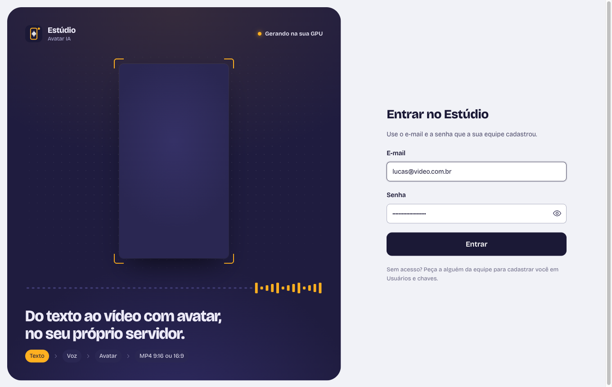

Para sair, clique no ícone de saída ao lado do seu nome, no canto inferior esquerdo.

## 2. Conhecer o painel

O menu à esquerda tem quatro grupos:

| Grupo | Telas | Para que serve |
|---|---|---|
| Vídeos | Novo vídeo, Histórico | Gerar um vídeo curto e acompanhar todos os vídeos da equipe. |
| Aulas | Nova aula, Aulas, Identidade | Montar aulas com várias cenas, abertura e encerramento com o seu logo. |
| Biblioteca | Avatares, Cenários | Cadastrar as pessoas que falam e os fundos. |
| Acesso | Usuários e chaves | Liberar outras pessoas e criar chaves para sistemas externos. |

Na primeira entrada, a tela **Novo vídeo** avisa que ainda não há avatar nem cenário. Comece pela Biblioteca.

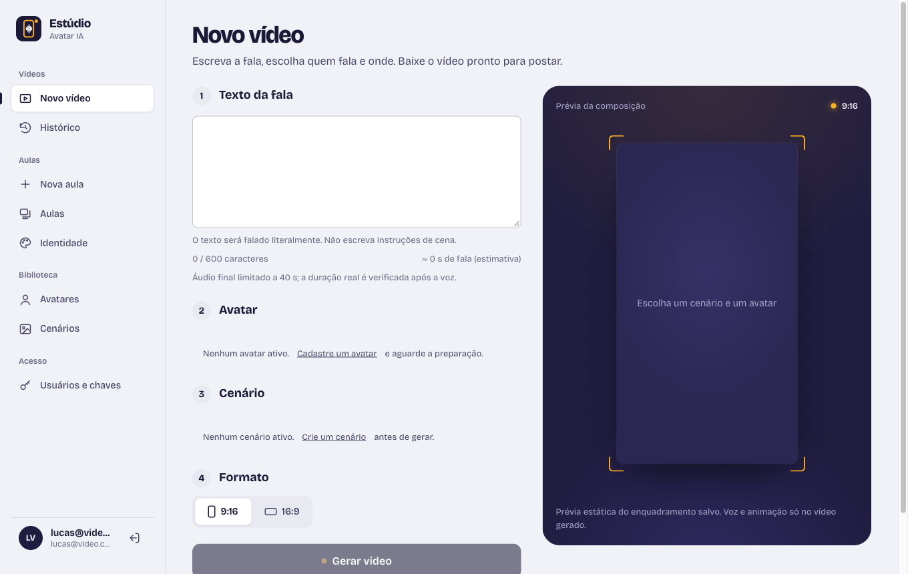

## 3. Cadastrar avatares

O avatar é a pessoa que fala no vídeo. Ele nasce de uma foto e tem uma voz, feminina ou masculina.

**Como deve ser a foto**

* JPEG, PNG ou WebP, até 20 MB.
* Pessoa de frente, com rosto e ombros visíveis e boa luz.
* Uma pessoa só na foto. O fundo é removido automaticamente.
* Use apenas fotos de pessoas que autorizaram o uso da imagem.

**Passo a passo**

1. Abra **Avatares** e clique **Cadastrar avatar**.

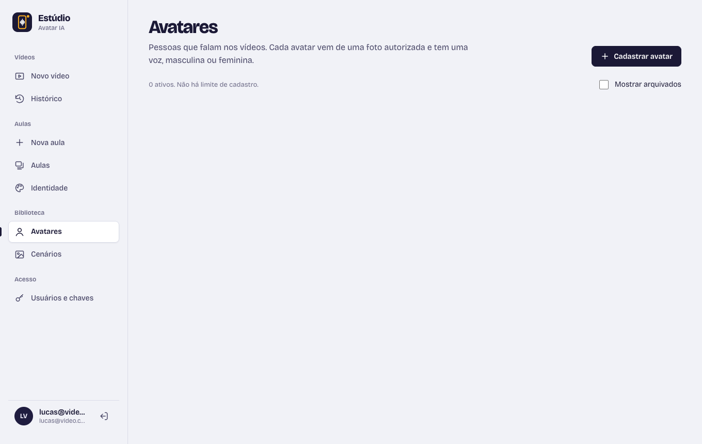

2. Arraste a foto para a área indicada ou clique nela para escolher o arquivo.

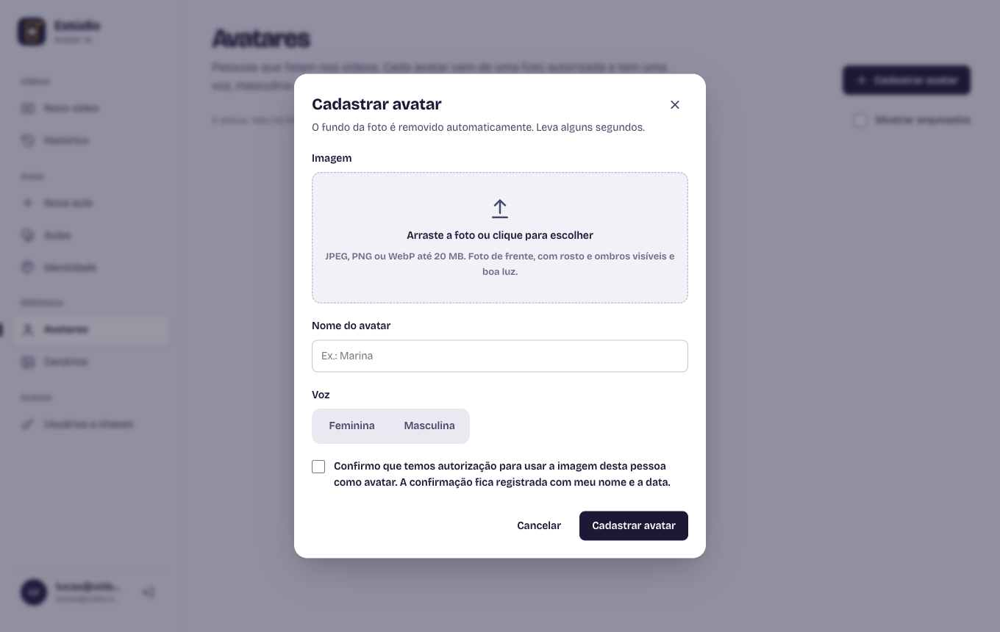

3. Dê um nome ao avatar, escolha a voz e marque a confirmação de autorização. A confirmação fica registrada com o seu nome e a data.
4. Clique **Cadastrar avatar**.

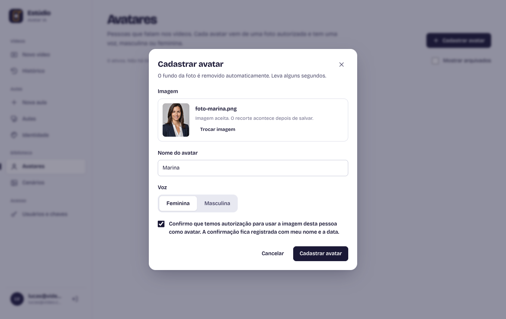

5. O avatar aparece como **Recortando o fundo**. Leva alguns segundos e a tela atualiza sozinha.

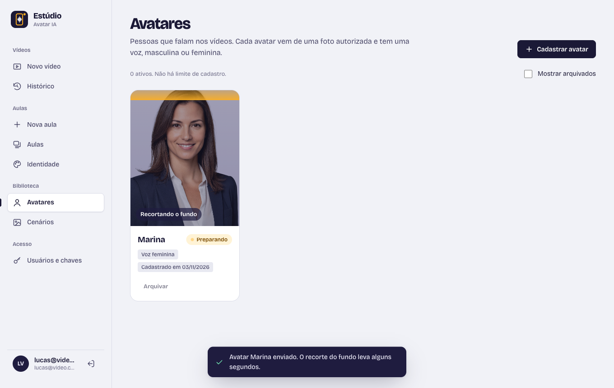

6. Quando aparecer **Ativo**, o avatar já pode ser usado em vídeos, aulas e pela API.

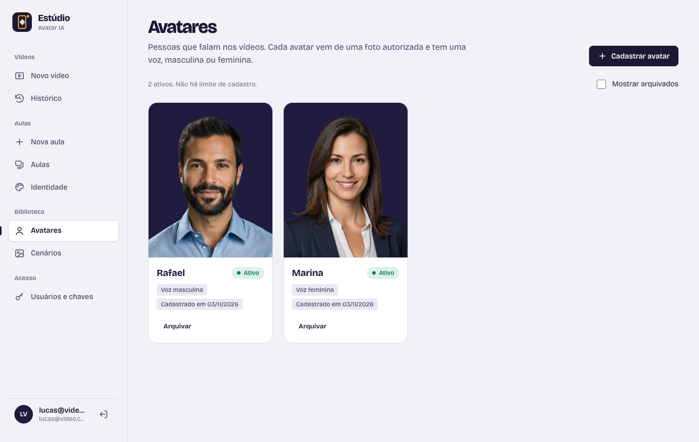

Se a preparação falhar, a tela mostra o motivo. Normalmente basta trocar a foto por outra com a pessoa mais visível.

**Arquivar** tira o avatar das escolhas de novos vídeos. Os vídeos que já foram feitos com ele continuam disponíveis. Marque **Mostrar arquivados** para vê-los de novo.

## 4. Criar cenários

O cenário é o fundo atrás do avatar. Ele guarda também onde e de que tamanho a pessoa aparece, em cada formato de vídeo.

1. Abra **Cenários** e clique **Criar cenário**.

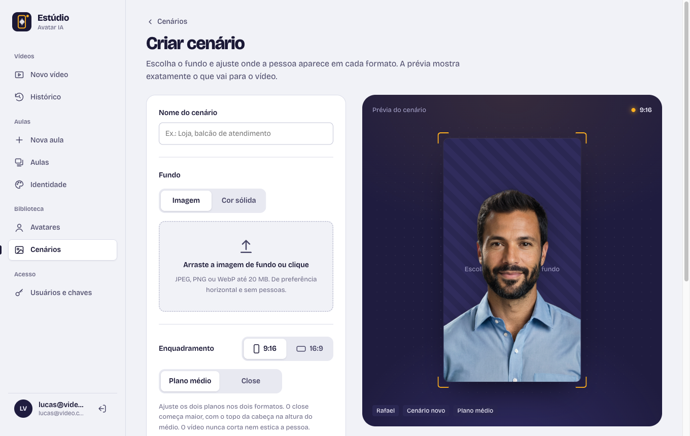

2. Dê um nome ao cenário.
3. Em **Fundo**, escolha **Imagem** e envie a foto do ambiente (de preferência horizontal e sem pessoas), ou escolha **Cor sólida**.
4. Em **Enquadramento**, ajuste o formato vertical **9:16** (Reels, Stories, TikTok) com os controles **Escala**, **Posição horizontal** e **Base**. A prévia à direita mostra exatamente o que vai para o vídeo.

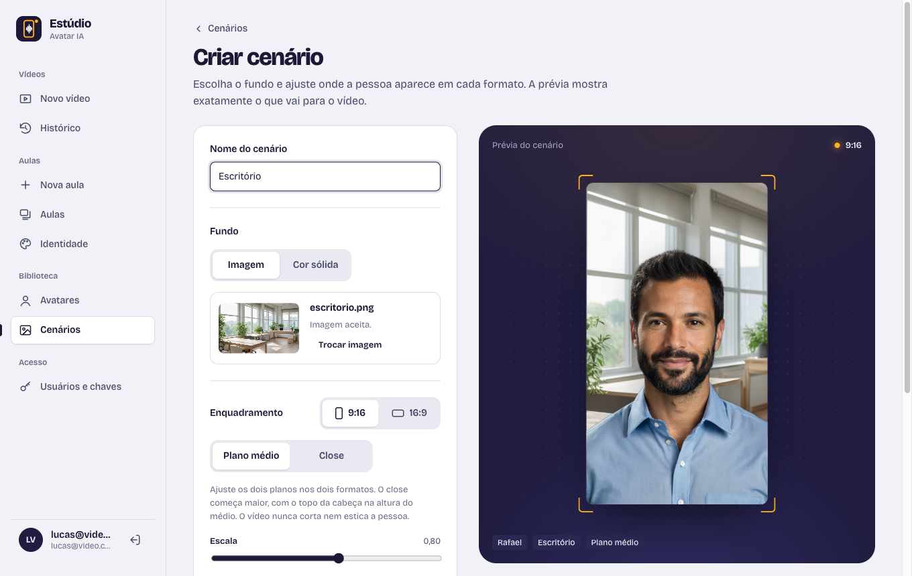

5. Troque para **16:9** (horizontal, YouTube e aulas) e ajuste de novo. Faça o mesmo em **Close**, o plano mais próximo do rosto usado nas aulas.

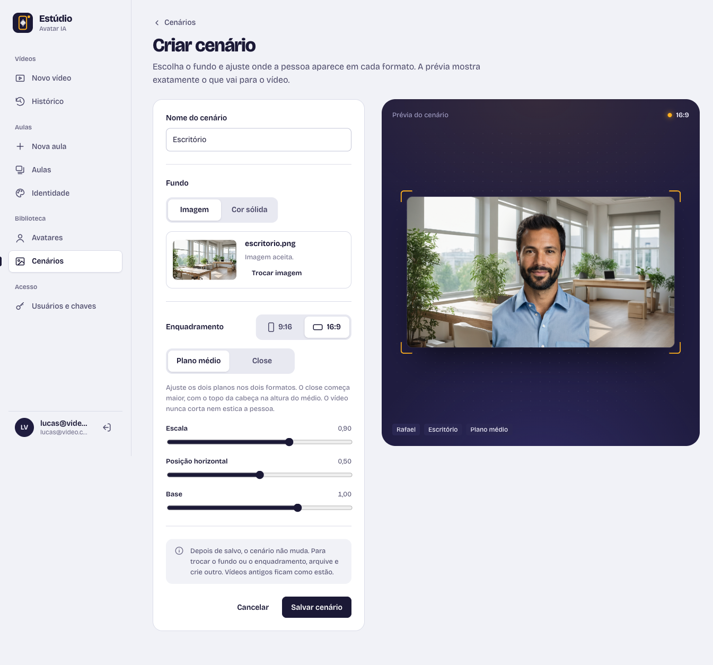

6. Clique **Salvar cenário**.

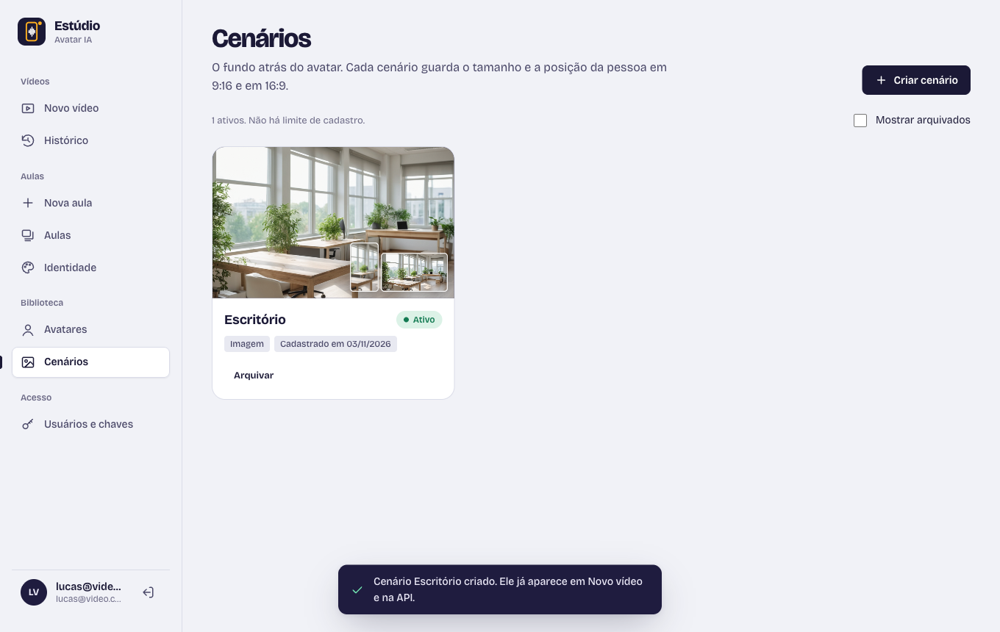

Depois de salvo, o cenário não muda. Para trocar o fundo ou o enquadramento, arquive o cenário e crie outro. Os vídeos antigos ficam como estão.

## 5. Gerar um vídeo

1. Abra **Novo vídeo**.
2. **Texto da fala:** escreva exatamente o que o avatar vai dizer. O texto é falado palavra por palavra. Não escreva instruções como "sorria" ou "mude de cenário".
3. **Avatar:** escolha quem fala. A voz vem do cadastro do avatar.
4. **Cenário:** escolha o fundo.
5. **Formato:** **9:16** para vertical ou **16:9** para horizontal.
6. Confira a prévia à direita e clique **Gerar vídeo**.

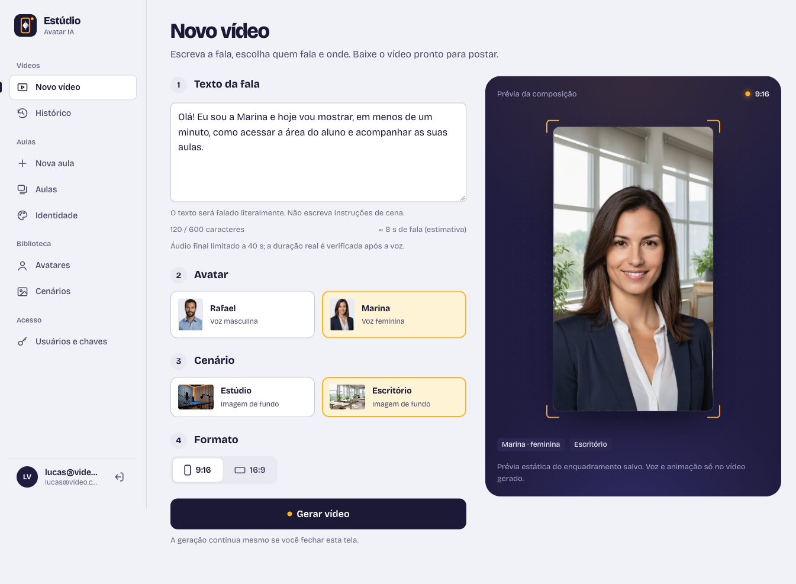

Abaixo do texto, o contador mostra quantos caracteres cabem e uma estimativa da duração. O limite vale para o áudio final: se a fala passar do tempo máximo, encurte o texto.

Depois do clique, o pedido já está salvo no servidor. Pode fechar a tela: a geração continua.

**Acompanhar o vídeo**

A tela do vídeo atualiza sozinha:

| Estado | O que significa | O que fazer |
|---|---|---|
| Na fila | Pedido salvo, aguardando o gerador. | Aguardar ou voltar depois. |
| Processando | O vídeo está sendo gerado. As etapas são Compor, Voz, Animar, Finalizar e Salvar. | Aguardar. |
| Pronto | Vídeo concluído. | Assistir e clicar **Baixar MP4**. |
| Falha | A geração terminou com erro. A tela mostra o motivo e um código. | Ver a seção [Quando algo dá errado](#10-quando-algo-dá-errado). |

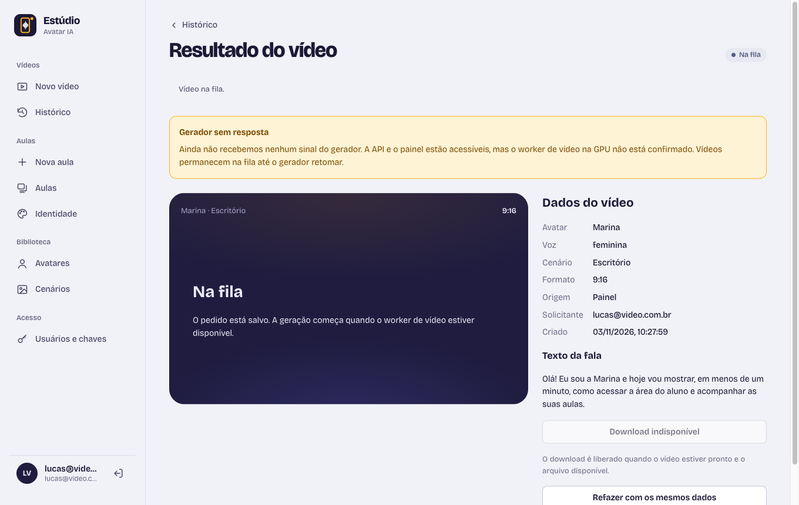

O aviso **Gerador sem resposta** aparece quando o servidor de vídeo (GPU) está desligado ou sem sinal há mais de 2 minutos. O pedido continua salvo na fila e começa sozinho quando o gerador voltar.

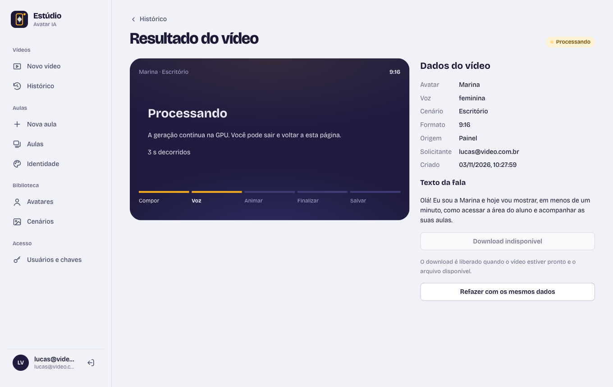

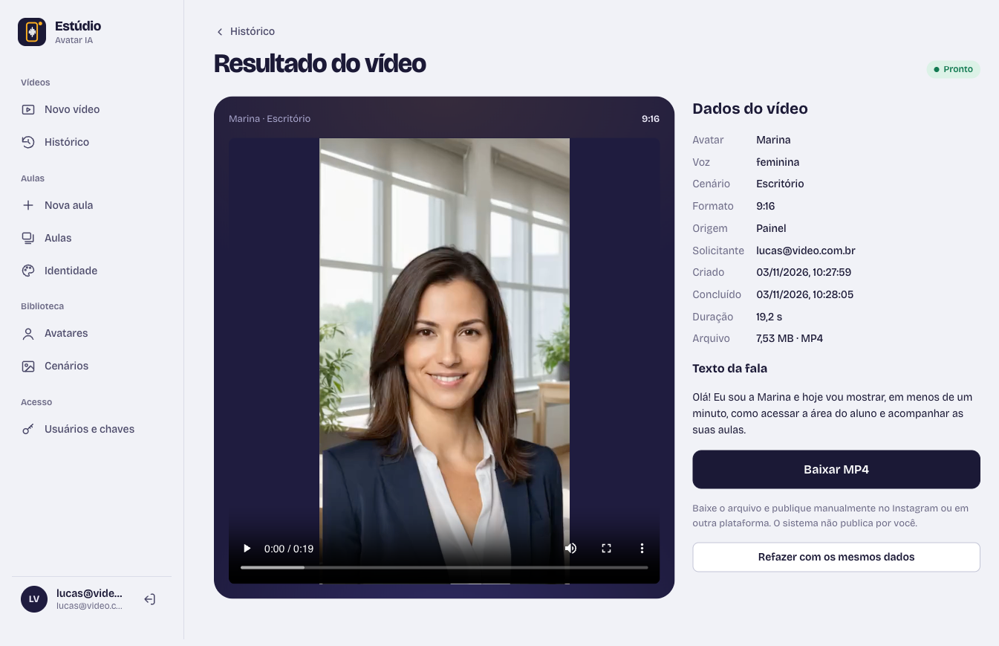

O MP4 sai pronto para redes sociais: 1080x1920 (vertical) ou 1920x1080 (horizontal), 25 quadros por segundo, H.264 com áudio AAC. A publicação no Instagram ou em outra rede é feita por você: o sistema não publica sozinho.

**Refazer com os mesmos dados** copia o texto, o avatar, o cenário e o formato para um novo pedido. Nada é enviado até você clicar **Gerar vídeo** de novo.

## 6. Histórico

**Histórico** mostra todos os vídeos da equipe, feitos pelo painel ou pela API, com quem pediu, a origem, o formato e a data. Use o filtro **Estado** para ver só os que estão na fila, prontos ou com falha. Clique **Ver vídeo** para abrir um deles.

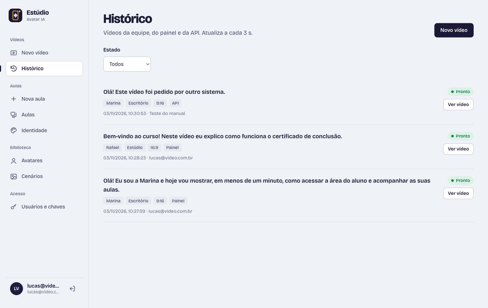

## 7. Aulas

Uma aula junta várias cenas curtas num único MP4, com abertura e encerramento de 3 segundos na identidade visual da sua marca. Cada cena pode ter um plano diferente, tópicos na tela e uma imagem, como uma captura de tela do seu sistema.

### 7.1 Identidade visual (uma vez só)

1. Abra **Identidade**.
2. Envie o logo, em PNG ou JPEG. Prefira o logo com fundo transparente.
3. Escolha a **Cor de fundo** e a **Cor de destaque** (formato `#RRGGBB`).
4. Clique **Salvar identidade**. A prévia mostra a abertura e o encerramento.
5. Opcional: envie uma **trilha de fundo** (MP3, WAV, M4A ou OGG, até 20 MB). Use só músicas que vocês têm direito de usar.

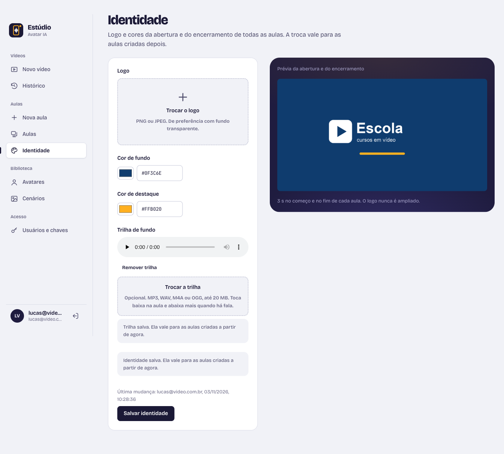

Trocar o logo, as cores ou a trilha vale para as aulas criadas depois. As aulas antigas não mudam.

### 7.2 Criar uma aula

1. Abra **Nova aula** e escolha o avatar, o cenário e o formato.

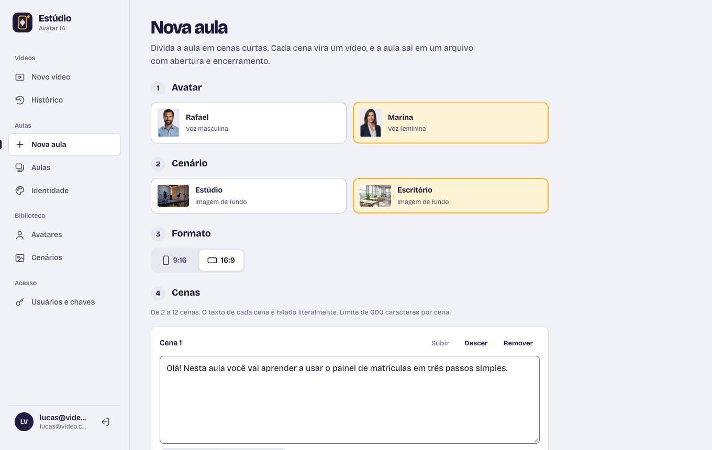

2. Monte as cenas na ordem em que vão aparecer (de 2 a 12 cenas). Em cada cena:
   * **Texto:** o que será falado. A legenda mostra este mesmo texto.
   * **Plano:** **Plano médio** mostra o apresentador inteiro no enquadramento do cenário; **Close** aproxima no rosto. Alternar os planos deixa a aula menos cansativa.
   * **Tópicos** (opcional): um por linha, até 5 por cena, até 80 caracteres cada.
   * **Imagem** (opcional): uma por cena, em JPEG, PNG ou WebP. Durante a cena, a imagem ocupa a tela e o apresentador vai para um quadro menor no canto.

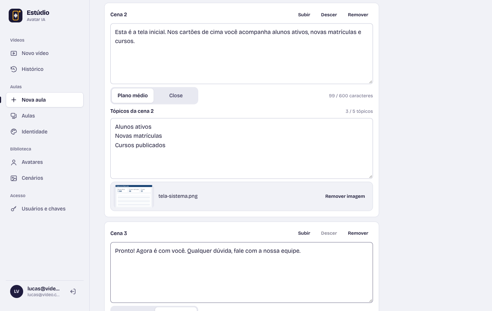

3. Use **Adicionar cena**, **Subir**, **Descer** e **Remover** para organizar.
4. Marque **Tocar a trilha de fundo** se quiser a música da identidade. Ela fica baixa e abaixa mais quando o apresentador fala.
5. Clique **Gerar aula**.

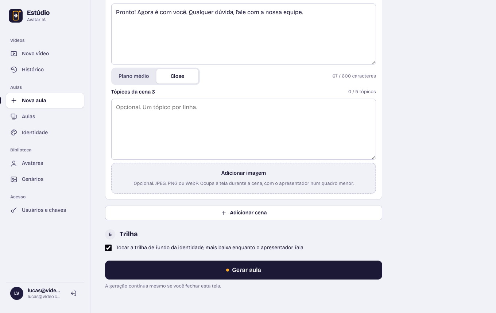

### 7.3 Acompanhar e baixar

A tela da aula atualiza sozinha e mostra o estado de cada cena:

| Estado | O que significa |
|---|---|
| Gerando cenas | As cenas estão sendo geradas, uma de cada vez. |
| Montando | Todas as cenas ficaram prontas e o servidor está juntando abertura, cenas e encerramento. |
| Pronta | O MP4 final está salvo. Assista no player e clique **Baixar MP4**. |
| Falha | Uma cena ou a montagem falhou. A tela diz qual cena e o motivo. |

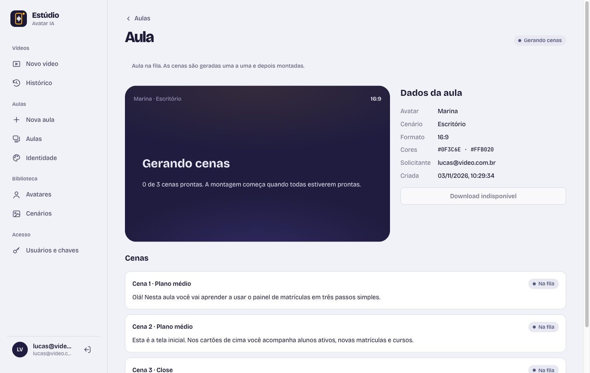

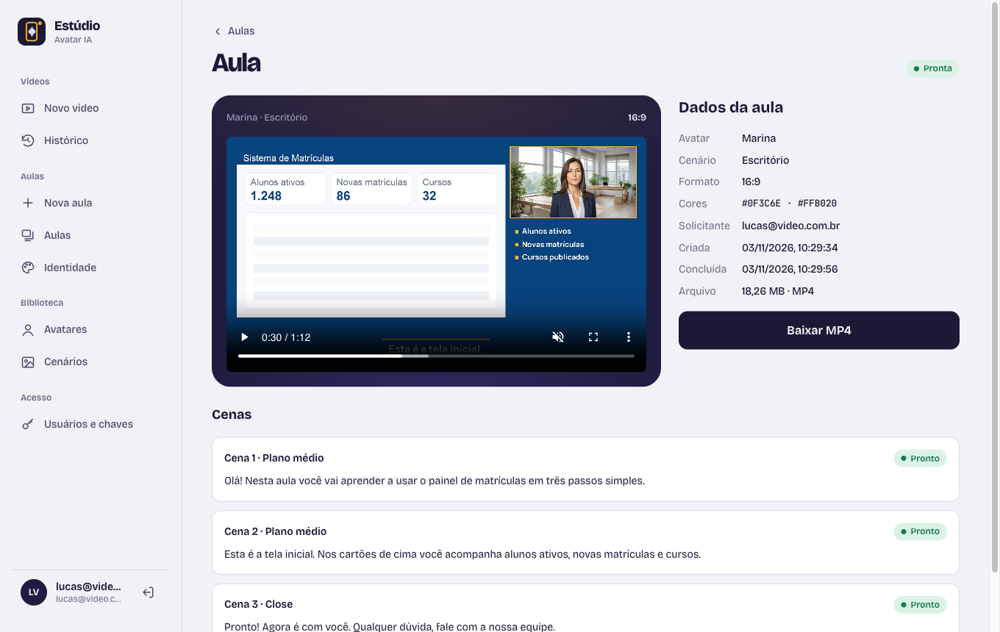

**Aulas** lista todas as aulas da equipe com o andamento.

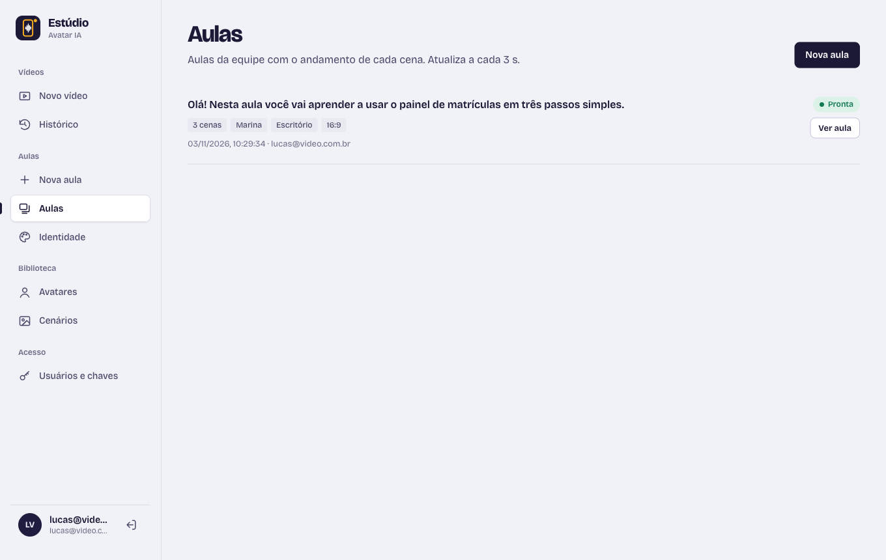

Se uma cena falhar, corrija o que o motivo indicar (por exemplo, encurtar uma fala longa demais) e crie a aula de novo.

## 8. Usuários e permissões

Todas as pessoas com acesso têm as mesmas permissões: gerar vídeos e aulas, cadastrar avatares e cenários e gerenciar pessoas e chaves. Não há perfis diferentes.

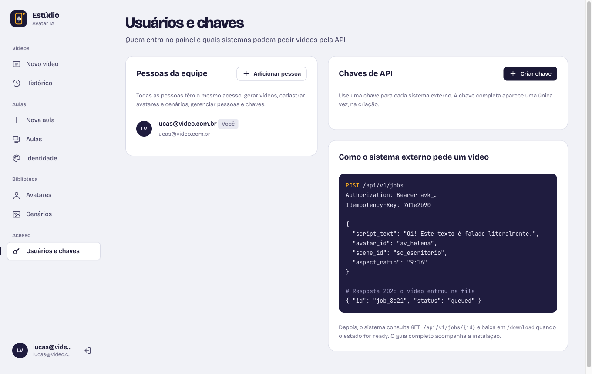

**Pelo painel**

1. Abra **Usuários e chaves** e clique **Adicionar pessoa**.
2. Informe o nome, o e-mail e uma senha inicial com pelo menos 12 caracteres.
3. Clique **Adicionar pessoa** e passe a senha para a pessoa por um canal seguro.

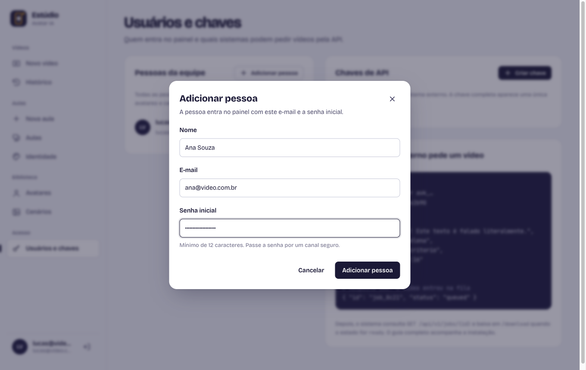

Para tirar o acesso de alguém, use **Remover** ao lado do nome. A pessoa sai na hora de todas as sessões abertas. As chaves de API criadas por ela continuam valendo: revogue-as também, se for o caso.

**Pelo servidor (root)**

Quem administra o servidor também pode criar pessoas e trocar senhas por um script. Ele gera uma senha provisória e a mostra uma única vez. Rode na pasta do sistema, no servidor:

```bash
bash infra/scripts/create-user.sh --username nome@empresa.com.br
```

Para trocar a senha de alguém que esqueceu (isso também devolve o acesso de quem foi removido e encerra as sessões abertas):

```bash
bash infra/scripts/create-user.sh --username nome@empresa.com.br --reset
```

O sistema ainda não tem "esqueci minha senha" nem troca de senha pelo painel. Use o comando acima.

## 9. Ligar outro sistema pela API

A API (interface para outro sistema conversar com este) permite que um software seu peça vídeos sem passar pelo painel: o seu sistema envia o texto, o avatar e o cenário, acompanha o andamento e baixa o MP4. Avatares e cenários continuam sendo cadastrados no painel.

Hoje a API gera vídeos avulsos. Aulas com várias cenas são criadas só pelo painel.

### 9.1 Criar a chave

1. Em **Usuários e chaves**, clique **Criar chave**.
2. Dê um nome que identifique o sistema, por exemplo "Sistema de matrículas", e clique **Criar chave**.

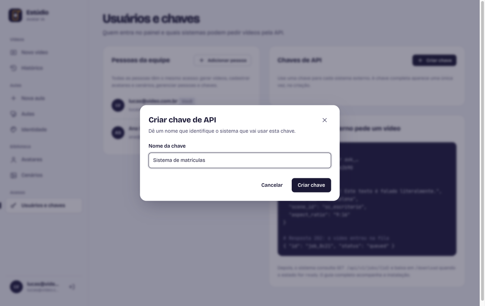

3. Copie a chave e guarde no sistema que vai usá-la. Ela aparece uma única vez.

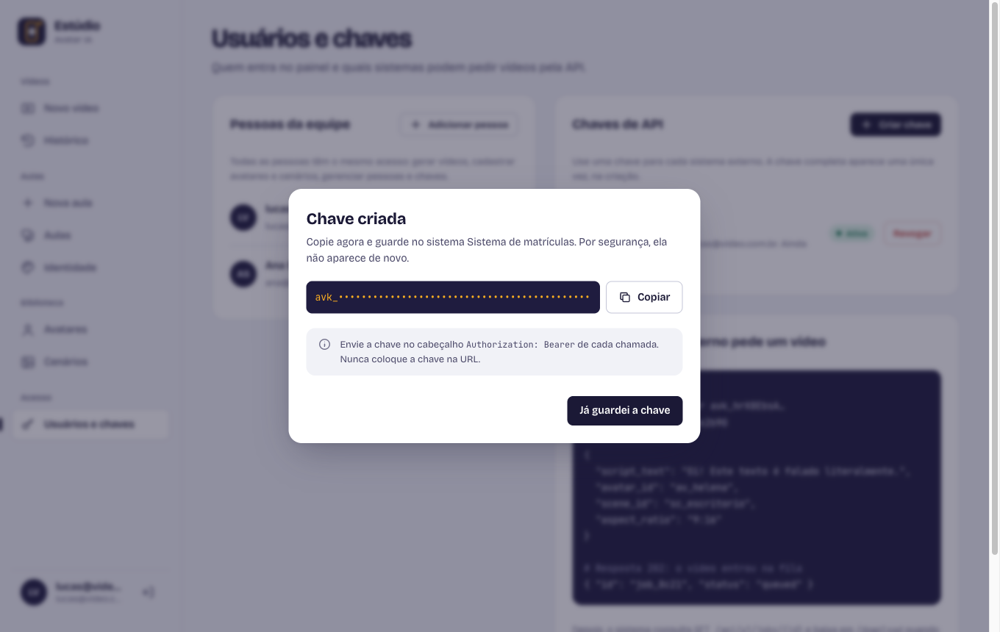

4. Use uma chave por sistema. Quando um sistema deixar de usar a API, clique **Revogar**.

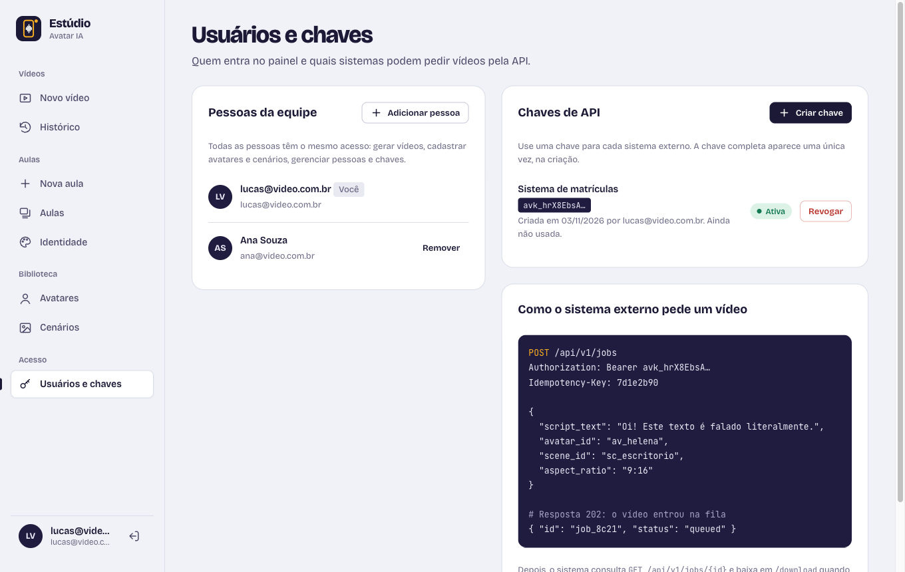

Cuidados com a chave: ela vai sempre no cabeçalho `Authorization: Bearer`, nunca na URL. Não coloque a chave em páginas web, no código do repositório ou em logs.

### 9.2 Endereço

A API fica no mesmo endereço do painel, no caminho `/api/v1`. Com o túnel da seção 1, o endereço para testes é `http://localhost:8088`. Para ligar um sistema que roda em outro servidor, o sistema precisa de um domínio com HTTPS; aí o endereço passa a ser `https://seu-dominio`.

Nos exemplos abaixo, troque `API_URL` pelo endereço e `API_KEY` pela chave:

```bash
export API_URL=http://localhost:8088
export API_KEY=cole-a-chave-aqui
```

### 9.3 Passo a passo

**1. Listar avatares e cenários ativos.** Guarde os `id` de quem vai falar e do fundo.

```bash
curl "$API_URL/api/v1/avatars" -H "Authorization: Bearer $API_KEY"
curl "$API_URL/api/v1/scenes" -H "Authorization: Bearer $API_KEY"
```

Resposta:

```json
{"items":[{"id":"0f3b9945-d708-4bad-9bc8-43a2d2a858ce","name":"Marina","voice":"feminina","preview_url":"/api/v1/avatars/0f3b9945-d708-4bad-9bc8-43a2d2a858ce/preview","created_at":"2026-11-03T13:26:49Z"}]}
```

**2. Pedir o vídeo.** O `aspect_ratio` é `9:16` (padrão) ou `16:9`. O cabeçalho `Idempotency-Key` é um identificador único por pedido (um UUID, por exemplo): se a resposta se perder e o seu sistema reenviar o mesmo pedido com a mesma chave, o vídeo não é criado duas vezes.

```bash
curl -X POST "$API_URL/api/v1/jobs" \
  -H "Authorization: Bearer $API_KEY" \
  -H "Idempotency-Key: 6f1c2b8e-4a1d-4c3e-9d70-2b5f0c1e7a11" \
  -H "Content-Type: application/json" \
  -d '{"script_text":"Olá! Este vídeo foi pedido por outro sistema.","avatar_id":"ID_DO_AVATAR","scene_id":"ID_DO_CENARIO","aspect_ratio":"9:16"}'
```

Resposta `202`, o pedido entrou na fila:

```json
{"id":"3771fbfe-4351-4ebc-a3be-cde988b801de","status":"queued","status_url":"/api/v1/jobs/3771fbfe-4351-4ebc-a3be-cde988b801de","download_url":null}
```

**3. Acompanhar.** Consulte a cada 3 segundos até o `status` ser `ready` (pronto) ou `failed` (falha). Os outros valores são `queued` (na fila) e `processing` (gerando).

```bash
curl "$API_URL/api/v1/jobs/ID_DO_VIDEO" -H "Authorization: Bearer $API_KEY"
```

```json
{"id":"3771fbfe-4351-4ebc-a3be-cde988b801de","status":"ready","download_url":"/api/v1/jobs/3771fbfe-4351-4ebc-a3be-cde988b801de/download","stage":null,"aspect_ratio":"9:16","error":null}
```

**4. Baixar o MP4.**

```bash
curl "$API_URL/api/v1/jobs/ID_DO_VIDEO/download" -H "Authorization: Bearer $API_KEY" --output video.mp4
```

Os vídeos pedidos pela API também aparecem no **Histórico** do painel, com a origem **API** e o nome da chave.

### 9.4 Exemplo completo em JavaScript

Salve como `exemplo.mjs` e rode com `node exemplo.mjs` (Node.js 18 ou mais novo) ou `bun exemplo.mjs`, sem instalar nada:

```js
import { writeFile } from "node:fs/promises";

const API_URL = process.env.API_URL;
const headers = { Authorization: `Bearer ${process.env.API_KEY}` };

async function call(path, options = {}) {
  const response = await fetch(API_URL + path, { ...options, headers: { ...headers, ...options.headers } });
  if (!response.ok) throw new Error(`HTTP ${response.status}: ${await response.text()}`);
  return response;
}

const avatars = (await (await call("/api/v1/avatars")).json()).items;
const scenes = (await (await call("/api/v1/scenes")).json()).items;

let job = await (await call("/api/v1/jobs", {
  method: "POST",
  headers: { "Content-Type": "application/json", "Idempotency-Key": crypto.randomUUID() },
  body: JSON.stringify({
    script_text: "Olá! Este vídeo foi pedido por outro sistema.",
    avatar_id: avatars[0].id,
    scene_id: scenes[0].id,
    aspect_ratio: "9:16",
  }),
})).json();

while (job.status === "queued" || job.status === "processing") {
  await new Promise((resolve) => setTimeout(resolve, 3000));
  job = await (await call(job.status_url)).json();
}
if (job.status === "failed") throw new Error(`${job.error.code}: ${job.error.message}`);

const video = await call(job.download_url);
await writeFile("video.mp4", Buffer.from(await video.arrayBuffer()));
console.log("Vídeo salvo em video.mp4");
```

Um exemplo em Python e todos os detalhes (erros, limites e o contrato OpenAPI) estão no [guia da API](../api/GUIA.md).

### 9.5 Respostas de erro

Os erros vêm sempre no mesmo formato:

```json
{"error":{"code":"SCRIPT_TOO_LONG","message":"Texto acima do limite da receita vigente.","field":"script_text","request_id":"7b142e3a..."}}
```

| HTTP | Quando acontece | O que fazer |
|---|---|---|
| 401 | Chave ausente, errada ou revogada. | Conferir a chave e o cabeçalho `Authorization`. |
| 404 | Vídeo não existe ou foi criado por outra chave. | Conferir o `id`. Cada chave só vê os próprios vídeos. |
| 409 | Download antes de ficar pronto, ou `Idempotency-Key` repetida com outro conteúdo. | Esperar o `ready`; usar uma chave nova para cada pedido. |
| 422 | Pedido inválido, por exemplo texto longo demais (`SCRIPT_TOO_LONG`). | Corrigir o campo indicado em `field`. |
| 503 | Geração indisponível no momento. | Tentar mais tarde ou falar com o suporte. |

## 10. Quando algo dá errado

| Situação | O que fazer |
|---|---|
| "E-mail ou senha incorretos" | Conferir o e-mail e a senha. Se esqueceu, peça ao administrador para trocar a senha (seção 8). |
| A página não abre | Conferir se o túnel SSH da seção 1 está aberto. |
| Aviso **Gerador sem resposta** | O servidor de vídeo está desligado. Os pedidos ficam na fila e começam quando ele voltar. |
| Avatar com falha na preparação | Enviar outra foto, de frente, com a pessoa bem visível. |
| Vídeo com falha `INPUT_INVALID` | A fala ficou maior que o tempo máximo. Encurte o texto. |
| Falha `OUT_OF_MEMORY`, `WORKER_LOST`, `RENDER_FAILED` ou `OUTPUT_INVALID` | Problema no gerador. Envie o código e o horário ao suporte; não reenvie várias vezes. |
| **Arquivo indisponível** num vídeo pronto | O arquivo sumiu do armazenamento. Fale com o suporte. |

## Checklist do teste

* [ ] Entrei com `lucas@video.com.br`.
* [ ] Cadastrei um avatar feminino e um masculino.
* [ ] Criei um cenário e ajustei 9:16 e 16:9.
* [ ] Gerei e baixei um vídeo vertical e um horizontal.
* [ ] Cadastrei a identidade visual com logo e cores.
* [ ] Gerei e baixei uma aula com pelo menos 3 cenas, uma delas com imagem.
* [ ] Adicionei outra pessoa da equipe.
* [ ] Criei uma chave de API e pedi um vídeo por outro sistema.
