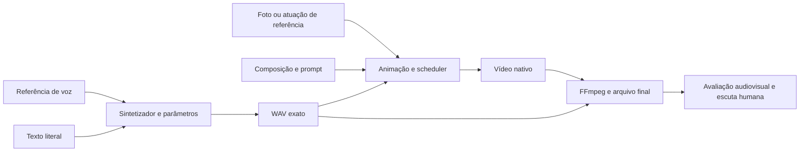

# P06 — investigação de naturalidade

Pesquisa e ensaios de 15/10/2026. A P06 permanece incompleta. O objetivo é voz, movimento e sincronia percebidos como naturais nas amostras reais aprovadas pelo cliente. Nenhum teste lexical, watermark ou MP4 válido substitui esse aceite.

## O que a investigação mudou

A hipótese “open-source não tem qualidade” é ampla demais para orientar uma correção. O resultado depende de referência, texto, sintetizador, configuração, imagem/atuação, animação e finalização. A pesquisa foi dividida entre voz, vídeo e avaliação, em três frentes independentes. Foram lidos código, documentação, papers e demos dos próprios autores; alegações dos mantenedores não foram tratadas como resultado obtido neste projeto.

A transcrição diagnosticou conteúdo; não ouviu nem aprovou prosódia. A inspeção visual do agente cobre quadros e dados temporais, com limites declarados. Esta sessão não oferece entrada de áudio ao agente: não há alegação de audição própria. A página de revisão fornece os arquivos ao avaliador humano real.

## Hipóteses que podem ser refutadas

| Hipótese | Evidência concreta | Experimento e resultado que a enfraquece |
|---|---|---|
| A referência transmite a saudação exagerada. | O áudio sintético Kokoro usado para condicionar começa em “Olá!”. A reclamação humana é justamente esse início. O Chatterbox condiciona voz e estilo pela referência. | Mesmo texto, seed e parâmetros: referência original versus remoção dos primeiros 0,53 s de silêncio/saudação. Repetir a ablação em outro sintetizador. Ausência de melhora humana em ambos enfraquece a hipótese; não implica incapacidade de todos os modelos. |
| O perfil de quatro passos está com integração de scheduler inadequada. | O adaptador omite sample_shift: o CLI fixado resolve 7 em 480p e 11 em 720p. O exemplo LoRA usa 2, mas o comando mostrado é FusionX com 8 passos; não prova um ótimo para nossa LightX2V com 4 passos. | Par com shift 7/2 e todo o resto igual, incluindo seed 42, WAV e imagem. Se só a voz mudar ou a imagem for recomposta, o par deixa de isolar o scheduler. Ainda sem inferência GPU. |
| A instrução e o plano da imagem limitam o corpo. | O prompt antigo proíbe gestos e a foto de busto corta os ombros. Nas demos V2V dos autores, a atuação de braços já existe na entrada. | Primeiro só prompt positivo; depois fonte da mesma pessoa com ombros/torso completos. Não pedir anatomia invisível e chamar qualquer invenção de movimento natural. |
| A finalização introduz atraso global. | No arquivo antigo, TTS e AAC decodificado têm correlação 0,999974 e lag 0 ms; PTS de vídeo regulares a 25 fps. | Esses dados enfraquecem deslocamento introduzido pelo mux, mas não refutam erro de alinhamento boca–fonema do modelo. SyncNet com controles deslocados é um teste separado, executado e descrito abaixo. |
| A ampliação de resolução explica parte da aparência. | O vídeo 1080p veio de inferência 448×832. | Comparar resolução nativa com o mesmo áudio/imagem e controles, quando houver GPU e orçamento. Exportar 1080p sozinho não testa mais detalhe gerado. |

A remoção de 0,53 s altera conteúdo, duração e a janela inicial da referência. Portanto a ablação testa o conjunto dessa referência, não separa perfeitamente duração de estilo. Não há alegação de causalidade demonstrada apenas pela duração do WAV novo.

## Prática observada nos autores

No [Chatterbox](https://github.com/resemble-ai/chatterbox), referência e idioma precisam ser coerentes; controles expressivos não equivalem a naturalidade conversacional. O código local usa uma voz Kokoro sintética para condicionar outro sintetizador: é uma cascata que precisa de controle próprio. O fato de uma frase dizer “naturalidade” não instrui acusticamente o modelo a ser natural.

O [Qwen3-TTS](https://github.com/QwenLM/Qwen3-TTS) declara português. O Base aceita referência e transcrição; a alternativa CustomVoice não fornece uma voz nativa brasileira dentre os presets descritos. Foi escolhido Base 1.7B sem quantização para o ensaio, com o mesmo áudio de referência. Isso verifica uma alternativa, não comprova sotaque pt-BR ou superioridade antes da escuta. O port [MLX-Audio 0.5.9](https://github.com/Blaizzy/mlx-audio/tree/v0.5.9) foi inspecionado: lang_code, referência/transcrição para ICL, repetition_penalty efetivo mínimo 1,5; Base não recebe instrução de estilo por instruct.

Na [demonstração oficial do InfiniteTalk](https://meigen-ai.github.io/InfiniteTalk/), foram inspecionados arquivos de imagem, vídeo de entrada e saída, além de metadados e grades. A V2V humana parte de uma pessoa com braços/mãos e gestos já visíveis. A I2V observada usa figuras ilustradas, também com membros desenhados. As demos são curadas e não expõem tentativas descartadas, seed ou configuração de cada saída. Não foram usadas como assets do produto.

O [exemplo LoRA do InfiniteTalk fixado](https://github.com/MeiGen-AI/InfiniteTalk/blob/50aa0a94184315407a991ae804d9b58d6d311ba8/README.md#L300-L320) e o código do scheduler fundamentam o ensaio de shift. Quatro passos com LightX2V são suportados; culpar apenas a contagem de passos seria outra hipótese não demonstrada.

## Ensaios de voz realizados

Todos os arquivos brutos e monitores ficam na área privada `video-generation-amostras/p06-pesquisa-naturalidade-20261015/experimentos/`, com requests, scripts, versões e hashes. Não há substituição da receita de produção.

O controle E repetiu a configuração A anterior e produziu o mesmo SHA-256 de WAV: `3c916d3f4163a911e3207f6367377abb829c76951127de5e5e3520ddc892797c`. Isso valida a reprodutibilidade local observada; não aprova a voz já reprovada pelo usuário.

O desenho inicial é 2×2: Chatterbox e Qwen, cada qual com referência original e com crop sem saudação. A referência continua sintética nos quatro casos. As configurações são fixas dentro de cada modelo; os hiperparâmetros e a seed não possuem significado numérico equivalente entre os dois motores. Uma amostra por célula serve à triagem, sem significância estatística nem taxa de sucesso estimada.

| Caso | Modelo/referência | Duração real | Diagnóstico lexical automático |
|---|---|---|---|
| E | Chatterbox, original | 8,24 s | Palavras recuperadas nos dois ASRs; WAV igual ao A anterior. |
| F | Chatterbox, sem saudação na referência | 9,40 s | Palavras recuperadas nos dois ASRs. |
| G | Qwen 1.7B, original | 8,88 s | Large: “Conto”; small-q4: “Conte”. Divergência pendente de escuta. |
| J | Qwen 1.7B, sem saudação na referência | 8,16 s | Palavras recuperadas nos dois ASRs. |
| H | Qwen 1.7B, referência masculina original | 8,32 s | “aproxima pessoas” versus “a próxima pessoas”; conferir pronúncia. |
| I | Qwen 1.7B, stress numérico original | 27,28 s | Pedido 218, negativas e final recuperados. Preço e telefone ainda divergentes; fidelidade crítica sem aprovação. |

Os seis processos concluíram com saída zero e EOS aceito/observado. Isso não resolveu automaticamente a voz robótica ou os números. Os dois transcritores pertencem à família Whisper; os erros são correlacionados. Nesta rodada o segundo checkpoint é small-q4 em cache, distinto do small não quantizado do diagnóstico anterior; revisões constam nos JSONs.

A página privada `p06-pesquisa-naturalidade-20261015/revisao.html` apresenta as quatro células femininas com rótulos neutros e ordem fixa embaralhada. Os players principais usam cópias PCM16 a volume comum de −23,5 LUFS, obtido apenas por ganho constante. Os raws continuam preservados; hashes das cópias ouvidas ficam em `mapa-comparacao-voz.json`. Não houve compressão, mudança de velocidade ou de duração. O retorno humano posterior considerou a amostra 2 próxima, mas com início percebido como pt-PT, e a 4 razoável, ainda precisando melhorar. Nenhuma foi aprovada; veja [a investigação de sotaque](P06-SOTAQUE.md).

Praat via Parselmouth 0.4.7/Praat 6.1.38 mediu F0, intensidade e pausas em CPU. Essa versão usa autocorrelação clássica; não foi apresentada como o método filtrado mais recente. As medianas de F0 E/F/G/J foram aproximadamente 202/183/185/186 Hz. Não existe limiar de naturalidade nesses números: não escolhem a voz vencedora e não substituem ouvir as frases.

No Chatterbox foram preservados D001/EOS, política v3, pesos e watermark. No Qwen, o wrapper observa o token EOS real da primeira codebook e recusa saída sem ele. O limite local é 512 tokens; nenhuma saída truncada é tratada como sucesso. Os WAVs Qwen deste ensaio não têm watermark Perth: não foram disfarçados como resultados do estágio de produção. Uma adoção futura exige integração/manifesto/contrato e validações próprias.

## Controle adicional sem cascata

Foi executado Kokoro 0.9.4 diretamente, com `pf_dora`, `speed=1,0`, seed registrada e o mesmo texto feminino. O runtime CPU persistente foi usado em leitura; a inferência em sandbox sem rede concluiu em 13,03 s, com WAV de 7,125 s/171.000 amostras, PCM16 mono/24 kHz, sem clipping. O raw tem SHA-256 `32fb3d9a2ddf1d53284e3645bcb0ea4b2afa88548a0b6b8552213a52d317e19f`. Uma cópia de escuta recebeu apenas ganho constante de +3,46 dB: −23,50 LUFS/−2,42 dBTP, sem mudança de duração.

Esse controle remove a etapa de clonar a referência sintética e ajuda a testar onde surge a entonação reprovada. Não demonstra que a cascata causa o defeito nem que a versão direta é melhor. Não houve ASR novo dessa subtarefa ou audição pelo agente. A API Kokoro não expõe token EOS; o campo foi marcado não aplicável, sem simular D001. Watermark é nulo. A página mostra o controle separado das quatro células; scripts, dados, licenças e hashes ficam em `diagnostico/kokoro-direto/`.

## Avaliação com ferramentas reais

Foram usados FFmpeg/FFprobe, análise de PCM, NumPy/SciPy e imagens de contato. O áudio TTS original foi comparado ao áudio do MP4, separadamente do problema labial. O protocolo de voz inclui Praat por Parselmouth, pausas e ganho constante para controlar volume na escuta, sem converter essas medidas em MOS humano.

[SyncNet](https://github.com/joonson/syncnet_python) foi executado em CPU com modelo oficial, crop manual e três janelas. Os controles de áudio deslocado em ±200/400 ms recuperaram exatamente os deslocamentos injetados. O vídeo antigo teve offset estimado de −2 frames (−80 ms) nas três janelas, sugerindo áudio atrasado pelo critério desse estimador. Isso não prova alinhamento perceptivo absoluto nem mede naturalidade corporal. Uma cópia diagnóstica atrasou apenas a imagem em dois quadros, sem cortar o áudio. A reavaliação deu offset zero nas mesmas três janelas e manteve os controles exatos. O AAC decodificado permaneceu idêntico. A cópia tem 651 quadros/26,04 s; o áudio mantém 25,96 s. Não houve compensação automática na produção. Consulte [o registro SyncNet](P06-SYNCNET-ENSAIO.md). MediaPipe/OpenCV podem acompanhar cabeça/ombros e movimento residual; não foram executados neste ciclo. Preditores de qualidade de fala têm limites de domínio e idioma; não foram usados para aprovar português. Pesos NISQA oficiais não são tratados como licença comercial MIT só porque o código é MIT.

O protocolo de comparação humana deve usar os mesmos textos e sistema de reprodução, volume controlado, rótulos neutros e ordem alternada. Avaliar separadamente saudação, ritmo, pronúncia, fim de frase, timbre e naturalidade. Conservar empates e “nenhuma atende”. Depois repetir a candidata em outras frases e seeds, mantendo também as falhas. Sem número suficiente de avaliadores, relatar preferência individual, sem teste de significância artificial.

Não foi introduzido banco de dados ou serviço novo para poucas amostras. JSON/CSV e hashes preservam os dados brutos e permitem análise posterior. Isso evita acrescentar infraestrutura sem relação demonstrada com o defeito.

## GPU e próxima comparação visual

O console Verda foi consultado com o acesso existente em 15/10/2026, aproximadamente 16:16 UTC. Saldo confirmado US$ 0,38. A100 de 80 GB apareceu com Notify me; SKUs H100 spot 1× apareceram em Unavailable instances, local None, US$ 2,085/h. Nenhuma máquina, chave ou recarga foi criada. Esse é o estado observado, não garantia de disponibilidade posterior.

O par de scheduler fica preparado com entradas/hash idênticos e overlay privado. Não houve nova inferência de avatar nesta pesquisa; a cópia temporal deriva do vídeo antigo. O desempenho anterior e o saldo não sustentam prometer toda a matriz. A próxima janela deve conferir capacidade, saldo, custo do par e armazenamento original antes de criar compute. Créditos restantes devem ser usados conforme a autorização vigente, sem recarga automática.

## Fontes detalhadas e limites

- [Voz, idioma, modelos e implementações](P06-VOZ-FONTES.md).
- [Vídeo, demos observadas e propagação de parâmetros](P06-VIDEO-FONTES.md).
- [Métricas, protocolos, licenças e diagnóstico audiovisual](P06-AVALIACAO-FONTES.md).

As fontes e os experimentos sustentam hipóteses específicas. Não foi localizada prova de produção que reproduza nossa pessoa, pt-BR, cenário, resolução e orçamento com uma taxa de sucesso conhecida. A evidência útil para decidir é o resultado preservado de cada comparação e a avaliação humana real.
